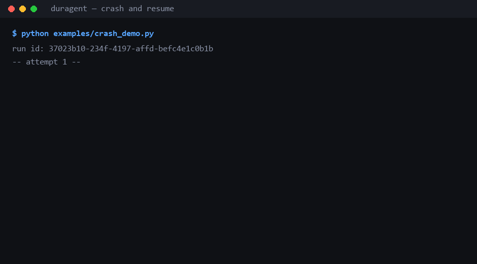

# Duragent

**Durable execution for AI agents.** Every step writes its result to a database before the next one
starts, so a crash replays finished work instead of repeating it.

[](https://github.com/a643036114-sys/duragent/actions/workflows/ci.yml)



*A three-node agent crashes in the middle. The restart replays the finished node: the model is not
called twice, the refund is not sent twice.*

📖 **Why this exists** — [你的 Agent 会重复扣钱吗？我给 LangGraph 加了一层"步骤日志"](https://juejin.cn/post/7705396726358114346)：
一次退款发了两次的事故复盘，以及三句 SQL 怎么解决。（中文）

```python
from duragent import Journal, connect, new_run_id

conn = connect("agent.db")
journal = Journal(conn, new_run_id())

graph.add_node("plan",   journal.durable("plan", plan_fn))
graph.add_node("refund", journal.durable("refund", refund_fn, needs_approval=True))
```

That is the whole integration. Everything below is what those two lines buy you.

---

## The accident this exists for

A support agent has five steps: read the ticket, search the knowledge base, draft a reply, **issue a
refund**, send the email. It takes forty seconds.

At second thirty, the process restarts — a deploy, an OOM kill, a provider timeout, anything.

- **Without the journal:** the pipeline re-runs from the top. The model is called again (money), and
  the refund goes out a second time (a real incident).
- **With the journal:** finished steps replay from storage, the model is not called, only the
  unfinished step executes.

The framework you are using probably does not cover this. LangGraph's checkpointer records *which
node you reached*; resuming from it re-executes that node, side effects included. It tells you where
you were, not what you already did.

## How it works

A step is claimed by primary key, executed once, and its result stored:

```
        ┌──────────────┐   no record      ┌───────────────────────┐
call ──▶│ SELECT step  │─────────────────▶│ INSERT claim (PK)     │
        └──────────────┘                  └───────────┬───────────┘
               │ record exists                        │ execute body
               ▼                                      ▼
     SUCCEEDED ──▶ replay stored JSON       persist output, status = SUCCEEDED
     FAILED    ──▶ retry (attempt + 1)
     RUNNING   ──▶ lease alive? block  :  take over (attempt + 1)
```

`(run_id, step_key)` is the lock. `UPDATE ... WHERE status = 'RUNNING'` row count is the ownership
check. No `SELECT FOR UPDATE`, no Redis, no advisory locks — the same four statements run on SQLite,
PostgreSQL and MySQL.

That design has consequences worth naming:

| Decision | Why | Cost |
|---|---|---|
| Journal the **result**, not a snapshot | Replays are free and diffable | O(n) replay per resume |
| Lease instead of row lock | A 30-second model call must not hold a connection | A dead worker's step re-runs |
| Abort releases the claim, never writes `FAILED` | A refused approval must not look retryable | Loses the attempt record |
| Money as integer micro-units | `0.1 + 0.2 != 0.3` | Slightly uglier API |

Longer reasoning: [ADR 0001](docs/adr/0001-durable-step-as-the-primitive.md),
[0002](docs/adr/0002-claim-by-primary-key.md),
[0003](docs/adr/0003-replay-instead-of-snapshot.md),
[0004](docs/adr/0004-aborts-do-not-poison-the-journal.md).

## Quickstart

```bash
pip install -e "python[dev,langgraph]"
cd python && python -m pytest -q          # 101 passed, 6 skipped
```

See the crash for yourself:

```bash
cd python
PYTHONPATH=src python examples/crash_demo.py
```

```
-- attempt 1 --
  [plan]   calling the model ...
  crashed at 'write': 529 overloaded (simulated upstream failure)

-- attempt 2: a new process, same database --
  [write]  calling the model ...
  [publish] writing the file ...

-- journal after two attempts --
  step         status     attempt  executions
  plan         SUCCEEDED  1        1
  write        SUCCEEDED  2        2
  publish      SUCCEEDED  1        1
```

`plan` shows **one** execution across two attempts. That is the entire pitch in one line.

## What is in the box

| | Feature | One line |
|---|---|---|
| 🗒 | **Durable steps** | A node runs once; later calls replay its stored result. |
| 🙋 | **Approvals** | A gated node parks the run as `SUSPENDED`; no thread is held, the process may exit. |
| 💸 | **Budgets** | Token, money, step and wall-clock caps. Atomic spend ledger, hard stop, raise-and-resume. |
| 🔁 | **Retries** | Exponential backoff stored as a `not_before` deadline, so the run returns on schedule. |
| 👷 | **Workers** | Claims, heartbeats, lease takeover when a peer dies. |
| 🧬 | **Fingerprints** | Detects "same run, different input" and raises instead of returning stale work. |
| 🌿 | **Fork** | Re-run from any completed step, keeping the history before it. |
| 🔍 | **Diff** | Compare two runs step by step, using the outputs already stored. |
| 🖥 | **Console + API** | One HTML page and ten endpoints: create, inspect, list, fork, diff, approve, reject, metrics. |
| 🧹 | **Sweeper** | Closes overdue approvals so a suspended run cannot wait forever. |

### Approvals

```python
journal.durable("refund", refund_fn, needs_approval=True,
                reason="refund 500 CNY", expires_in=3600)
```

First call parks the run and raises `ApprovalRequired`. Later:

```python
approve(conn, approval_id, by="manager@corp", comment="ok")
```

The next invoke replays everything before `refund` and executes it exactly once. A rejection fails
the run. An overdue request is closed by the worker's sweep thread or by `expire_stale(conn)`.

### Budgets

```python
set_budget(conn, run_id, max_cost=0.50, max_tokens=200_000, max_steps=30)
journal.charge(cost=0.02, tokens=1200)      # inside a node, where the cost is known
```

One conditional `UPDATE` both checks and spends, so two workers cannot take the last cent twice. A
refused charge is not billed; the run stops as `CANCELED` and `set_budget` with a bigger cap resumes
it from the current spend, not from zero.

### Retries

```python
journal.durable("call-llm", call_model, retry=Retry(max_attempts=4, base=1.0, multiplier=2.0))
```

Waits are 1s, 2s, 4s, capped by `max_delay`. While backing off the step raises `RetryLater`; the
worker records a `not_before` deadline and the claim query skips the run until then. After
`max_attempts` it raises `RetriesExhausted` and never executes again.

### Workers

```python
with Worker(conn, "worker-1", {"summary": handler}, lease=30, heartbeat_every=5) as worker:
    worker.drain()
```

A run is claimable when it is `PENDING`, or `RUNNING` with no live lease, and its deadline has
passed. The worker maps control flow to run state instead of treating everything as a failure:

| Raised by the handler | Run becomes |
|---|---|
| `ApprovalRequired` | `SUSPENDED` |
| `BudgetExceeded` | `CANCELED` |
| `RetryLater` | still `RUNNING`, scheduled later |
| anything else | `FAILED` |

### Fork and diff

```bash
duragent fork <run_id> --at write
duragent diff <run_a> <run_b>
```

A fork copies the journal rows that succeeded before the fork point; the fork point and everything
after it execute again. A snapshot-based runtime cannot do this, because it stores opaque state
rather than values. The forked run remembers its parent, so the console shows the comparison
automatically.

### Console

```bash
pip install -e "python[api]"
python python/examples/api_app.py
# http://127.0.0.1:8000/
```

One HTML file, no build step: runs on the left, steps, spend and pending approvals on the right,
with fork buttons on every completed step. `/metrics` exposes run counts, step counts and total
spend in Prometheus text format.

## Guarantees, stated honestly

| Situation | Behaviour |
|---|---|
| Step already succeeded | result replayed, function not called |
| Step failed | recorded as `FAILED`, retried per policy |
| Process died mid-step | lease expires, another worker re-executes it |
| Two workers, same step | one wins the claim, the other gets `StepInProgress` |
| Result is not JSON | `TypeError` — the journal stores JSON, so it must be |

The function runs **at least once**; its result is stored **at most once**. A crash between "the side
effect happened" and "the result was written" re-runs the function. `journal.key("refund")` gives you
a stable idempotency key to hand downstream and close that window.

Anything claiming exactly-once end-to-end is either lying or redefining the words. Full list of
sharp edges: [`python/README.md#known-limitations`](python/README.md#known-limitations).

## How it compares

| | What it runs | Extra infrastructure | Layer |
|---|---|---|---|
| **Temporal** | whole workflows | Server + database + workers | infrastructure |
| **DBOS** | plain Python functions | none (uses your Postgres) | function |
| **LangGraph Platform** | LangGraph graphs | hosted or self-hosted | runtime |
| **duragent** | LangGraph nodes | none (SQLite, or your Postgres) | node + debugging |

The concept is the same family as Temporal; the difference is scope and weight. Temporal is the
right answer for a company-wide workflow platform. This is the right answer for "my agent must not
double-charge, and I am not deploying a cluster for it".

Against LangGraph Platform the difference is visibility: it makes a run *reliable*, this makes it
*inspectable and forkable*.

## Architecture

```
python/                     the library (1,839 lines)
├── src/duragent/
│   ├── steps.py            the core: claim, execute, journal, replay
│   ├── graph.py            LangGraph node wrapper, fingerprints
│   ├── approvals.py        park a run, decide later, expire
│   ├── budgets.py          atomic spend ledger
│   ├── retry.py            backoff policy
│   ├── runs.py             run table, leases, scheduling
│   ├── worker.py           claim loop, heartbeat, sweep
│   ├── fork.py             branch a run from a completed step
│   ├── diff.py             compare two journals
│   ├── db.py               SQLite + PostgreSQL behind one interface
│   ├── api.py / cli.py     the two ways in
│   └── web/index.html      the console, 200 lines of vanilla JS
├── tests/                  17 files, 1,538 lines
├── benchmarks/             load test
└── examples/               seven runnable demos
java/                       a complete JVM implementation of the same design
docs/                       ADRs, status, launch material
```

Nothing in the core imports LangGraph. `graph.py` is the only adapter, and it is 123 lines.

## Testing

```bash
cd python && python -m pytest -q                          # 101 passed, 6 skipped
DURAGENT_PG_URL=postgresql://... python -m pytest -q      # 107 passed
```

Notable cases, because they are the ones that catch real bugs:

- **`kill -9` mid-step** — a subprocess calls `os._exit(9)`, the parent takes over after the lease.
- **Two processes, one journal** — a child computes a step, the parent replays it.
- **Two threads, one step** — exactly one executes, the other gets `StepInProgress`.
- **200 runs, 4 workers** — 600 steps, `0` duplicated runs.

```
$ python benchmarks/load_test.py --runs 200 --workers 4
           runs: 200
      completed: 200
          steps: 600
duplicated_runs: 0
  runs_per_second: 853
```

## FAQ

**Is it exactly-once?** No, and neither is anything else end-to-end. At-least-once execution plus
an idempotency key downstream is the honest version; `journal.key()` provides the key.

**Why not Temporal?** You would run a server, a database and worker processes for a graph that
lives forty seconds. If your workflows are hours long and company-wide, use Temporal.

**Why not LangGraph Platform?** It is a closed-source commercial runtime; self-hosting needs an
enterprise licence. If you already run it and it works for you, you do not need this.

**How is this different from DBOS?** Same instinct — durable execution as a library on your
existing database. DBOS is general-purpose; this is shaped around agents (node wrapping, approvals,
budgets, fork/diff).

**Does it work with a real model?** Yes: [`python/examples/real_llm_demo.py`](python/examples/real_llm_demo.py)
calls an OpenAI-compatible endpoint, prices it from the reported usage and crashes between nodes.
Verified against DeepSeek; CI runs it against a fake provider.

**Production ready?** No. It is `0.1.0`, there is one author, and the limitations are listed rather
than hidden. Read [`docs/status.md`](docs/status.md) for where it actually stands.

## Status and roadmap

`0.1.0`. Durable steps, approvals, budgets, retries, workers, fingerprints, fork, diff, CLI, HTTP
API, SQLite and PostgreSQL — 107 tests on two backends.

Next, roughly in order: fairness in claiming (one noisy workflow can starve others), real schema
migrations (additive only today), a hosted demo.

## 中文简介

Duragent 解决一个很具体的事故：agent 跑到一半进程崩了，重跑会把模型再调一遍、把退款再发一次。

它给每一步加一层日志：跑完把**结果**写进数据库，重跑时直接读结果、不执行函数。再配上租约（死掉的
worker 会被别人接管）、审批挂起（进程可以退出，几天后再继续）、预算熔断（花到上限就停，还能提额续跑）。

因为存的是结果而不是快照，它还支持**从任意一步分叉**、并 diff 两条分支的每一步输出——这是快照式引擎
做不到的，也是调试 agent 最常用的动作。

默认 SQLite，给个 URL 就是 PostgreSQL，不用起任何新服务。核心 `steps.py` 不到 200 行。

## License

Apache License 2.0. See [LICENSE](LICENSE).
